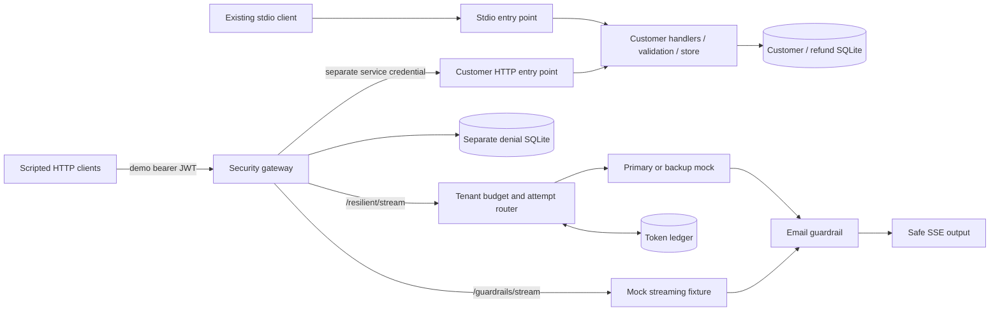

# BridgeLayer

BridgeLayer is a local backend prototype for controlled customer-support tool access and guarded streaming responses. Scripted clients can look up fictional customers, create simulated refunds, and receive email-redacted text from deterministic providers. An authenticated gateway enforces tool permissions; a separate streaming route adds tenant token budgets and one pre-output backup attempt.

**Tasks 1–4 are complete within the agreed prototype scope as of November 3, 2026.** See the [project overview and closeout](docs/PROJECT_CLOSEOUT.md) for what the system does, how the parts connect, and the final evidence. There is no live LLM, real payment integration, or operator UI.

Developed by **Yu-Chen Su (Will), Independent Software & AI Consultant**. The personal/FDE prototype was previously named SupportBridge and predates the active professional development phase beginning **September 11, 2026**. This is a customer-inspired integration case study, with no evidenced actual client engagement.

The English [product brief and business presentation](docs/business/README.md) introduce the prototype and proposed commercial collaboration for potential customers, investors, and partners.

## Problem being solved

Customer-support integrations need a clear boundary between incoming requests, authenticated callers, permitted operations, business rules, and stored results. BridgeLayer demonstrates those boundaries with discoverable MCP tools and reproducible success/failure cases. The current interface is a developer-operated client; no operator UI or LLM agent is implemented.

## Current capabilities

### Available Now

| Capability | Implemented behavior |
| --- | --- |
| Task 1: customer MCP service | Original stdio server with strict validation, lookup, simulated refunds, SQLite, and rollback tests. |
| Task 2: HTTP MCP security gateway | Stateless HTTP MCP with signed demo JWTs, role policy, request correlation, and separate downstream credentials. |
| Task 3: streaming email guardrail | Authenticated `/guardrails/stream` with deterministic mock bytes, bounded incremental redaction, cancellation, and a local demo; local verification and remote Node 22/24 CI are complete. |
| Task 4: token budgets and fallback | SQLite tenant reservations, usage reconciliation, and one pre-output backup attempt over deterministic model mocks; local checks and remote Node 22/24 CI are verified. |
| `get_customer_record` | Takes `customer_id`; returns a fictional record or business error. |
| `trigger_refund` | Takes `customer_id`, `amount`, `reason`; atomically stores a simulated refund and its success audit. |
| `admin_health_check` | HTTP-only harmless admin test tool; returns fixed health information without data changes. |
| Denial audit / diagnostics | Separate SQLite denial records; correlated gateway outcomes and durations; no bearer tokens or tool arguments in diagnostic fields. |
| Verification / demos | 66 tests/subtests, official SDK clients, fault injection, and four demos covering MCP, streaming, and resilience. |

Customer IDs require five ASCII digits after `CUST-`; extra arguments are rejected. Amounts must be finite positive numbers, with no string coercion; the store additionally requires safely representable whole cents. Reasons are trimmed before the ten-character minimum check. Receipts return integer `amount_cents`, USD currency, and simulated status.

### Optional extensions

All four agreed tasks are closed. Live LLM/provider integration, a React support console, external customer APIs, and hosted deployment are separate future work; they are not open acceptance items. See the [project closeout](docs/PROJECT_CLOSEOUT.md).

## Architecture



Both HTTP listeners bind loopback. The local launcher runs them in one Node process; these are separate HTTP trust boundaries, not OS-process isolation. Each POST has its own SDK transport; there is no shared MCP session state. The original stdio entry point remains available with two tools.

The gateway authenticates every request, leaves authenticated discovery unfiltered, and denies non-admin `admin_` calls before forwarding. Downstream headers are explicitly constructed; the client's bearer token is never passed through.

**No LLM chooses tools:** MCP demo clients call them explicitly. The streaming routes use predefined provider fixtures and do not invoke customer tools. See [architecture](docs/ARCHITECTURE.md) for boundaries and limitations.

## Example workflow

```sh
npm run demo:http
```

The temporary HTTP demo initializes viewer/admin clients and demonstrates:

1. A viewer discovers all three HTTP tools, including the admin tool.
2. Customer lookup returns fictional Alex Rivera.
3. A simulated refund returns `amount_cents: 1250`.
4. Viewer admin execution fails with `-32001: Unauthorized Tool Call`.
5. Admin execution succeeds.
6. Missing credentials fail with HTTP 401.

It generates temporary credentials/databases, does not print tokens, and cleans up afterward. `npm run demo` still runs the original stdio demonstration.

To exercise the email-only streaming path:

```sh
npm run demo:streaming
npm run bench:streaming
```

It accepts predefined synthetic fixtures rather than arbitrary prompts. Email-containing whitespace tokens are replaced as a whole; punctuation may also be removed. Existing customer MCP responses are not passed through this filter. No live LLM or general-purpose PII detection is implemented.

To exercise token accounting and primary/backup behavior:

```sh
npm run demo:resilience
```

This demonstrates per-tenant budgets, a primary 429/timeout followed by one backup, and failure without switching models after output. All token counts are synthetic; no live provider is called. See the [Task 4 walkthrough](docs/04-token-budgets-and-fallback-walkthrough.md).

## Tech stack

Repository pins: TypeScript `7.0.2`, MCP SDK `1.30.0`, Zod `4.5.4`, and `jose` `6.2.12` for JWTs. The application uses Node.js ES modules, built-in HTTP/SQLite, npm, and Node's test runner. No application HTTP framework, React app, or LLM SDK is introduced.

## Setup

Use Node 24 (`.nvmrc`); the package minimum is Node 22.13.0. Confirm `node --version` reports `v24.x` before installing dependencies.

```sh
npm ci
npm run check
npm run demo:http
```

The demo requires no external API key. For persistent HTTP operation, build, set two different secrets of at least 32 bytes, and run:

```sh
npm run build
export BRIDGELAYER_JWT_SECRET="$(node -e 'process.stdout.write(require("node:crypto").randomBytes(32).toString("hex"))')"
export BRIDGELAYER_SERVICE_KEY="$(node -e 'process.stdout.write(require("node:crypto").randomBytes(32).toString("hex"))')"
npm run start:http
```

Gateway: `http://127.0.0.1:3030/mcp`. Protected customer service: port `3031`. Stop with Ctrl+C. The [Task 2 walkthrough](docs/02-http-gateway-walkthrough.md) covers token issuance, configuration, protocol headers, failures, and audit lifecycle. Tokens issued by the local operator last at most 15 minutes; this is not a full OAuth authorization server.

For persistent stdio operation, use `node dist/src/mcp/stdio.js`. It waits for MCP input, not interactive terminal commands. A host should spawn Node directly; normal npm banners can contaminate protocol stdout.

Naming compatibility: package `supportbridge`, MCP server `supportbridge-customer`, `SUPPORTBRIDGE_DB`, default `data/supportbridge.sqlite`, and `supportbridge.code-workspace` retain their working names. Gateway denials default to `data/gateway-audit.sqlite`. Both database paths are configurable. Task 4 adds `data/token-budget.sqlite`, configurable with `BRIDGELAYER_BUDGET_DB`; the persistent launcher enables `/resilient/stream` on the gateway port.

## Testing

**November 1, 2026:** Task 4 clean installation, local type checking, and **66 tests/subtests** pass on Node **22.23.4** and **24.22.1**; all four demos pass on Node 24. These results include concurrent SQLite admissions and restart/fallback/cancellation cases. **November 3:** the Task 4 implementation revision `dc381fa` was confirmed to pass remote Node 22/24 installation and checks. See [Task 4 closeout and job links](docs/TASK4_CLOSEOUT.md).

**October 28, 2026:** Task 3 local type checking and **42 tests/subtests** pass on Node **22.23.4** and **24.22.1**. All three demos pass on Node 24; the [validation record](docs/TASK3_VALIDATION.md) includes benchmark results. **October 29:** remote Node 22/24 CI for the Task 3 implementation and current revision was verified successful; see the [closeout and run links](docs/TASK3_CLOSEOUT.md).

On **September 15, 2026**, local type checking and **23 tests/subtests** passed on Node `25.5.0`, including the existing six stdio tests and new HTTP integration/failure checks. The HTTP SDK-client demo also completed. The suite now verifies original refund/audit records after a complete server restart.

HTTP coverage includes token validation, direct-service rejection, zero downstream calls after denial, durable denial records, audit failure, Origin/Host checks, invalid/batched/oversize input, credential separation, concurrent identical request IDs, downstream reply validation, timeout, disconnect/shutdown cancellation, and log privacy.

Those September runs used installed dependencies. On **October 27, 2026 (Asia/Taipei)**, a clean dependency installation on Node **24.22.1** / npm **11.19.1**, type checking, all **23 tests/subtests**, and both HTTP/stdio demos passed. The existing [Node 22/24 CI run](https://github.com/willsu42/bridgelayer-mcp/actions/runs/35180116876) for `a744bfd` was also confirmed successful. See the [Task 2 closeout](docs/TASK2_CLOSEOUT.md) for exact installation conditions and evidence. Node may emit a SQLite warning on stderr without breaking protocol behavior.

Earlier recheck on September 16 (America/Chicago): type checking and all 23 tests/subtests passed again after request-cleanup changes; the original stdio demo also completed.

| Failure | Existing response |
| --- | --- |
| Missing/invalid gateway credentials | HTTP 401 with Bearer challenge |
| Non-admin `admin_` call | HTTP 200; JSON-RPC `-32001: Unauthorized Tool Call`, same ID |
| Invalid tool arguments / unknown tool | JSON-RPC `-32602` |
| Customer missing / unsupported money precision | Tool result `isError: true` |
| Unexpected customer-service exception | Sanitized JSON-RPC `-32603` |
| Invalid/unavailable downstream or audit failure | Sanitized HTTP 502 / `-32002` |
| Downstream timeout | HTTP 504 / `-32003`; operation outcome may be unknown |

See the [decision log](docs/decisions.md) for pinned SDK framing/error details and the [HTTP walkthrough](docs/02-http-gateway-walkthrough.md) for boundary-level HTTP errors.

## Current development status

**All four prototype tasks are closed.** The [consolidated closeout](docs/PROJECT_CLOSEOUT.md) records scope, final CI evidence, and optional extensions.

Task 1 predates September 11. Scope/documentation reconciliation belongs to the new phase; Task 2 and the restart regression were implemented and validated in this phase, with final scope acceptance and environment verification completed October 27, 2026. Git history has not been rewritten.

Limits: fictional records are shared, without tenant data isolation. Viewers can create simulated refunds; the admin-prefix rule is not real-payment authorization. Customer tool calls are never automatically replayed; aborting a timeout cannot undo a committed refund. Model-streaming fallback is limited to one eligible backup attempt before output. Denial auditing has no automated retention policy. There is no hosted deployment, measured production capacity, or live AI workflow. Task 4 budgets operate on synthetic provider token reports; they do not measure real model usage. The streaming guardrail covers documented email patterns only and currently uses deterministic mocks.

## Roadmap and learning

1. Task 1 — complete; stdio tool behavior is retained and covered by the final regression suite.
2. Task 2 — complete within the local gateway scope; clean-install/Node 24 checks, demos, and remote Node 22/24 CI are verified.
3. Task 3 — complete within the email-only mock-provider scope; local checks and remote Node 22/24 CI verified. See the [closeout](docs/TASK3_CLOSEOUT.md) and [progress report](docs/TASK3_PROGRESS.md).
4. Task 4 — complete within the deterministic-provider scope; local checks and remote Node 22/24 CI verified. See the [closeout](docs/TASK4_CLOSEOUT.md).

Read the [project plan](docs/PROJECT_PLAN.md), [initial phase scope](docs/PROJECT_SCOPE.md), and [development backlog](docs/DEVELOPMENT_PLAN.md). Start code discussion with the [stdio walkthrough](docs/01-mcp-walkthrough.md) and [HTTP walkthrough](docs/02-http-gateway-walkthrough.md). VS Code tasks/debugging and the [handoff](HANDOFF.md) support continuing the explain → agree → implement → demonstrate → practice workflow.
