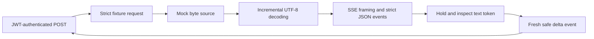

# Task 3 — Email guardrails over a byte stream

Implemented locally October 28, 2026. The user selected email addresses only. This service uses synthetic fixtures and an injected mock provider; it does not call an LLM or sanitize existing customer MCP results. Task 4's token budgets and fallback are not implemented.

## Run it

Activate Node 24 and check `node --version`, then run:

```sh
npm ci
npm run check
npm run demo:streaming
npm run bench:streaming
```

The streaming demo starts temporary loopback listeners and in-memory databases. It asserts three outcomes: a split email becomes `[REDACTED_EMAIL]`; a long unresolved token becomes `[REDACTED_OVERSIZE]`; a malformed provider stream terminates without emitting its pending email. Missing credentials return 401. It prints only the guarded text and fixed outcomes, and closes listeners/stores afterwards.

The persistent `npm run start:http` launcher also exposes `POST /guardrails/stream` on the gateway's existing port (3030 by default), using the same demo JWT configuration as [Task 2](02-http-gateway-walkthrough.md). Both viewer and admin may use this synthetic endpoint. Send JSON `{"fixture":"split-email"}`, `Content-Type: application/json`, `Accept: text/event-stream`, and a valid Bearer token. This route is ordinary HTTP/SSE, not an MCP tool or a new MCP transport mode. The existing `/mcp` route, SDK clients, and stdio contracts remain intact.

Allowed fixture names: `plain`, `split-email`, `email-heavy`, `long-token`, `malformed`, `truncated`. Extra request fields, arbitrary prompts, URLs, and provider selection are rejected. No caller-supplied data is sent to an external service.

## Follow the pipeline



Read [contracts.ts](../src/streaming/contracts.ts), [provider.ts](../src/streaming/provider.ts), [decoder.ts](../src/streaming/decoder.ts), [sse.ts](../src/streaming/sse.ts), [redactor.ts](../src/streaming/redactor.ts), [pipeline.ts](../src/streaming/pipeline.ts), and [http.ts](../src/streaming/http.ts) in that order. [mock.ts](../src/streaming/mock.ts) supplies deterministic, abort-aware byte fragments.

In Python terms, `AsyncIterable<Uint8Array>` is like an async generator of byte chunks. The text redactor is a separate stateful iterator: it must remember `alex` until later deltas reveal whether the token becomes `alex@example.com`. Holding one token is different from collecting the entire response.

UTF-8 is decoded incrementally with fatal errors. SSE parsing handles LF/CRLF/CR, a leading BOM, comments, multiple data lines, several events per chunk, and delimiters split across reads. The event payload is then parsed as JSON, so escaped `\u0040` is inspected as `@`. Lone surrogate escapes, malformed JSON, oversized text, and unknown application event types fail closed. Unused SSE fields are bounded and discarded.

The mock protocol contains `event: delta` with strict JSON `{"text":"..."}` and `event: done` with `{}`. Valid `done` is required; bare EOF, including an unfinished event, is an error. At parsed `done`, the adapter is cancelled and its iterator is closed without draining later events. Adapters must honor the abort signal; a third-party adapter that ignores it could retain its own background resources even though the request has terminated. No live adapter is currently present.

## Exact detection policy

The supported examples are common ASCII addresses with dot-separated local atoms (including plus tags), ASCII domain labels of 1–63 characters without leading/trailing hyphens, at least one domain dot, and a final alphabetic label of 2–63 characters. Ordinary supported local parts are 1–64 characters and full addresses at most 254 characters. Matching is case-insensitive for ASCII letters.

This is a conservative **substring detector**, not an address validator. For each `@`, it checks that the preceding character is an ASCII atom character and searches a bounded domain prefix of at most 252 characters. That preceding character alone is a valid local-part substring. Therefore malformed surrounding addresses, excessive local-part lengths, extra suffixes, punctuation, and Unicode beside an ASCII match may also be redacted. There is no promise that invalid addresses pass through.

Each non-whitespace token is held until whitespace or valid completion. If any supported substring appears, the entire token becomes `[REDACTED_EMAIL]`; otherwise the token is preserved. Whitespace follows JavaScript's Unicode-aware `\s` predicate and is preserved exactly. An unresolved prefix is never flushed on a timer or error. The [fixture table](../tests/fixtures/streaming.ts) fixes concrete cases:

| Input | Output |
| --- | --- |
| `Contact alex+support@example.co.uk now.` | `Contact [REDACTED_EMAIL] now.` |
| `(Alex.Rivera@EXAMPLE.COM), next` | `[REDACTED_EMAIL] next` |
| `世界alex@example.com🙂` | `[REDACTED_EMAIL]` |
| `a..b@example.com` | `[REDACTED_EMAIL]` (intentional false positive) |
| `alex@localhost` or `x@y.c` | Preserved; outside the supported pattern |
| Quoted local parts / IP domain literals | Not guaranteed; current fixtures are preserved |

Phone numbers, names, postal/government/payment identifiers, internationalized email, and obfuscated forms such as `alex [at] example [dot] com` are not covered. Some unsupported formats may incidentally match an ASCII substring. Existing MCP customer lookup still returns its fictional email unchanged. Do not describe Task 3 as a general PII filter.

## Resource and lifecycle behavior

| Boundary | Enforced behavior |
| --- | --- |
| Request | 4 KiB, strict fixture JSON, three-second read deadline; authentication first. |
| Pending token | 4096 UTF-8 bytes. On overflow, emit one oversize marker and discard until whitespace. No token prefix is released. |
| Source chunk / text delta | 16 KiB each. Oversize inputs terminate the stream; more than 64 consecutive empty source chunks are also rejected to bound non-progressing reads. |
| SSE line / event | 64 KiB each. Event accounting includes line endings normalized to one byte for CRLF, comments, and ignored fields; line accounting excludes its terminator. |
| Total provider input | 1 MiB per request, including bytes received in the chunk containing completion. |
| Concurrency | Four admitted requests per gateway process; excess requests fail with 503 before opening the provider. Slots include request-body processing and are released on every exit. |
| Waiting on provider | Three seconds per pending read; no idle-read timer while output is backpressured. |
| Entire HTTP request | Thirty seconds including authentication/body/output waits. A separate pipeline deadline also protects non-HTTP consumers. |
| Output | One raw fragment at a time, at most 4096 bytes (or a smaller fixed marker). JSON escaping makes the bounded SSE frame larger; `peak_frame_bytes` records delta frame size. No answer-sized queue. |

When a write returns false, the handler waits for drain, cancellation, or socket close before advancing the pipeline. A total timeout can terminate a blocked sink; an already blocked/destroyed socket is closed without queueing another error. These are application bounds, not limits on total RSS, OS buffers, or external-library allocations. Token look-ahead can delay safe output indefinitely until a boundary, subject to the overall deadline.

Before output starts, failures return sanitized JSON with an HTTP status: 400/413/415/406 for input, 401 for credentials, 403 for Host/Origin, 405 for method, 408 for body timeout, 502 for invalid/oversized provider data or audit failure, 504 for stream timeout, and 503 for capacity. After the first output, a writable stream receives one `error` event and closes; it never receives `done`. Previously emitted safe text cannot be retracted. Disconnection and shutdown abort the source; there are no retries or reconnects.

Outbound events are newly serialized and include only guarded text or a fixed error code. Successful output ends with exactly one `done`. `X-Request-ID` is generated by the server. Diagnostics contain IDs, fixed outcomes, byte counts, redaction/suppression counts, durations, and peak logical buffers. They contain no text, token, fixture arguments, or provider error strings. Metrics count raw output fragments separately from HTTP delta frames; the pipeline-only benchmark has no HTTP frame metric.

## Validation and measurements

The tests cover every two-part split of a short mixed UTF-8/SSE/JSON fixture, every text split across supported email fixtures, byte-at-a-time delivery, seeded chunk layouts, independent expected-output/prefix checks, overflow boundaries, malformed/truncated streams, deadline injection, cancellation, concurrency, audit failure, and credential/log privacy. Slow-consumer behavior is tested using a controlled writable and source-pull counters; real HTTP tests cover authentication, response events, disconnection, and shutdown. Existing MCP regression tests remain part of the same suite.

Run `npm run bench:streaming` for paired unredacted-reference and guarded pipeline measurements. The reference lives only in the benchmark script and is not exposed by HTTP. Measurements start at pipeline invocation, exclude HTTP/authentication, and include source pacing. Added release delay is reported only for aligned known-safe prefixes; other cases are `null`. Slow-consumer delay is applied per emitted fragment, so its total duration also reflects different fragment counts. Reported logical buffer peaks are not a heap profiler.

See [TASK3_VALIDATION.md](TASK3_VALIDATION.md) for actual local results and the remaining remote CI gate.
