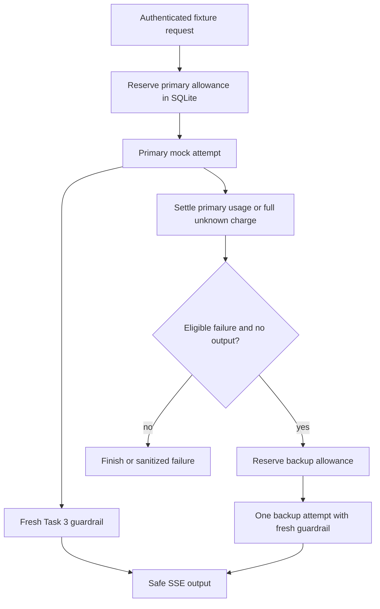

# Task 4 — Tenant token budgets and bounded fallback

Implemented locally November 1, 2026 (Asia/Taipei). This milestone demonstrates budget accounting and provider fallback with deterministic model mocks. No live LLM, tokenizer, API key, or paid request is involved. Remote Node 22/24 CI was verified November 3, closing this milestone; see [TASK4_CLOSEOUT.md](TASK4_CLOSEOUT.md).

## Run the demonstration

With Node 24 active:

```sh
npm ci
npm run check
npm run demo:resilience
```

The demo uses in-memory databases, random demo credentials, and a temporary loopback gateway. It asserts primary success, primary 429 followed by backup success, a real three-second first-text timeout followed by backup success, failure after output, backup failure, unknown usage, and denial for an independently depleted tenant. Successful text still passes through the Task 3 email guardrail. No tokens or raw email addresses are printed. The gateway's MCP downstream is unused in this demo; the normal launcher still starts the full customer service.

`npm run start:http` exposes `POST /resilient/stream` alongside `/mcp` and `/guardrails/stream`. The new route accepts a valid viewer/admin demo JWT, JSON content, and `Accept: text/event-stream`. An example body is:

```json
{"fixture":"split-email","scenario":"primary-429"}
```

`fixture` uses Task 3's existing fixed enum. `scenario` defaults to `normal`; allowed values are `normal`, `primary-429`, `primary-timeout`, `backup-failure`, `after-output`, and `unknown-usage`. Extra properties, including caller-supplied tenant IDs, token amounts, model names, and arbitrary prompts, are rejected.

The tenant comes only from the verified JWT. Different subjects/roles within one tenant share the same token allowance; a different authenticated tenant has an independent allowance. This isolates budget counters, not customer records. Existing MCP and Task 3 mock routes are unchanged in purpose and are not charged against this model-attempt budget.

## Request path



Both attempts use the same tenant ledger. A backup is not a free retry: it must reserve its own allowance after the primary is cancelled and settled. If that reservation fails, the backup never opens. Any storage/settlement failure also prevents fallback.

## Budget policy

| Setting | Implemented default |
| --- | --- |
| Tenant allowance | 50,000 simulated tokens |
| Usage window | Rolling 60 seconds, measured from attempt settlement |
| Per-attempt admission | Reserve 128 estimated input tokens + 256 output allowance = 384 |
| Provider output contract | Adapter receives `maxOutputTokens: 256` |
| Active reservation lease | 120 seconds, separate from the usage window |
| Request lifetime | Thirty seconds across primary, backup, and downstream waits |
| Database lock wait | 100 ms; contention fails closed without automatic retry |

These token amounts are server-owned demonstration policy. The mock reports explicit synthetic usage: normal primary success is 20 input + 20 output; backup success is 20 + 30; a simulated pre-dispatch primary 429 reports zero. These numbers are not derived from the fixture text and are not actual model-token counts. A live adapter would need a model-appropriate input estimator, an enforced output limit, and trustworthy final usage reporting.

Admission uses a short `BEGIN IMMEDIATE` transaction: recover expired reservations, remove expired terminal charges, sum tenant charges, and insert a reservation only if it fits. No provider call runs inside a transaction. Active rows charge their full reserved amount. Completed rows charge reported usage, or the full reservation when usage is unknown. Completion replaces the reservation charge; it does not add usage on top of it.

The rolling interval includes terminal charges whose settlement time is strictly greater than `now - 60 seconds`. A charge expires exactly at that boundary. Active reservations remain charged even after sixty seconds; they are never removed by historical usage cleanup.

On crash/restart, active rows remain reserved until their lease expires. The next ledger operation converts an expired active row to an unknown full charge and starts a fresh sixty-second usage window at recovery time. This deliberately favors under-admission over accidentally restoring quota after a crash. Late or duplicate settlement cannot refund an expired/recovered/settled attempt. No heartbeat is needed for the current thirty-second request bound and 120-second lease; a future longer-lived request requires a lease-renewal design.

Known nonnegative integer input/output usage is charged as reported. Invalid reports retain the full reservation and raise `USAGE_INVALID`. Valid counts above the reservation or either configured input/output allowance are charged as reported and also fail the request. Already incurred provider usage cannot be undone; a live adapter must honor the allowance to enforce a strict spending ceiling. Missing/throwing usage reports keep the full reservation, including after cancellation. Late reports do not retroactively reduce that charge.

All operations persist a nondecreasing ledger clock, so moving the system clock backward cannot restore allowance. Forward clock jumps still affect leases/windows; this is a local wall-clock policy, not distributed clock synchronization.

## Fallback rules

The first-text deadline is three seconds from attempt start until the first validated non-whitespace upstream text. Comments, framing bytes, and empty deltas do not count as useful text. This is distinct from the first safe output: the email guardrail may still be holding an unresolved token.

| Primary result | Behavior |
| --- | --- |
| Successful completion | Settle usage; return one success marker; no backup. |
| Provider 429 before output | Cancel and settle primary; try one separately admitted backup. Unemitted primary text is discarded. |
| First-text deadline before output | Cancel and settle primary; try one separately admitted backup. |
| Read stall after useful text | Terminate with timeout; do not start a backup, even if the guardrail has not yet emitted text. |
| Failure after any output | Error/close the existing stream; never append a different model's answer. |
| Malformed data, usage violation, caller cancellation, total deadline, or ledger failure | Fail without fallback. |
| Backup failure or timeout | Terminate; there is no third attempt. |

The router marks an attempt committed before handing any text fragment to the HTTP writer, including whitespace or a redaction marker. This is intentionally conservative. A backup gets a fresh decoder, parser, and redactor; primary prefixes cannot contaminate it. Late primary responses are ignored. Adapters must cooperate with cancellation to release their own resources; terminating a request cannot prove an arbitrary noncooperative adapter stopped external work.

One total deadline covers both attempts. The existing provider-read and backpressure controls remain active. Each streaming route has its own four-request cap per gateway process; this is separate from the shared tenant token budget. During shutdown, the gateway closes connections and waits for request handlers to settle reservations before the launcher closes SQLite.

## Persistence and errors

The launcher opens a separate database at `data/token-budget.sqlite`, configurable with `BRIDGELAYER_BUDGET_DB`. Existing customer and denial databases are unchanged. The new database contains a persisted policy/clock row and attempt rows with a UUID, authenticated tenant, primary/backup role, reservation amount, timestamps, state, and charged amount. No text, JWT, email address, or raw provider error is stored. Expired terminal rows are cleaned during ledger activity; this is a budget ledger, not a permanent audit history.

Reopening the database with incompatible policy settings fails rather than silently changing semantics. Settings overrides are constructor-level options used in tests; the HTTP client cannot choose them. WAL and atomic admissions are verified across independent worker connections to the same local file. No multi-host scaling claim is made. Synchronous SQLite calls can briefly block the event loop, so timers are not hard real-time guarantees.

Before output begins:

| Condition | HTTP status / fixed error code |
| --- | --- |
| Tenant has insufficient allowance | 429 / `BUDGET_EXHAUSTED` |
| Ledger unavailable or settlement fails | 503 / `BUDGET_UNAVAILABLE` |
| Attempt first-text timeout / overall or read timeout | 504 / `PROVIDER_TIMEOUT` or `STREAM_TIMEOUT` |
| Invalid usage report | 502 / `USAGE_INVALID` |
| Exhausted provider fallback or invalid provider data | 502 / `PROVIDER_RATE_LIMIT` or `INVALID_STREAM` |

After output begins, the same fixed failure code is sent in an `error` SSE event if writable, followed by closure and no `done`; an unwritable/disconnected socket is closed directly. Existing authentication, input-validation, and concurrency errors retain their shared HTTP behavior. There are no automatic client retries or refund/MCP replays.

## Code and verification

- [budget.ts](../src/resilience/budget.ts): atomic admission, settlement, recovery, cleanup, and policy consistency.
- [provider.ts](../src/resilience/provider.ts), [mock.ts](../src/resilience/mock.ts): request/usage contracts and deterministic failure scenarios.
- [router.ts](../src/resilience/router.ts): one primary/backup sequence, independent reservations, cancellation, first-text and total deadlines.
- [http.ts](../src/resilience/http.ts): verified tenant identity and the `/resilient/stream` adapter.
- [budget tests](../tests/budget.test.ts), [routing tests](../tests/resilience.test.ts), [HTTP tests](../tests/resilience-http.test.ts): boundaries, restart, races, isolation, and failure evidence.

The new route reuses the Task 3 HTTP writer and guardrail, with an optional validated-text hook to distinguish provider readiness from safe-output readiness. The original 42 tests/subtests remain part of the suite. Local results are in [TASK4_PROGRESS.md](TASK4_PROGRESS.md); completed remote verification is in [TASK4_CLOSEOUT.md](TASK4_CLOSEOUT.md).
