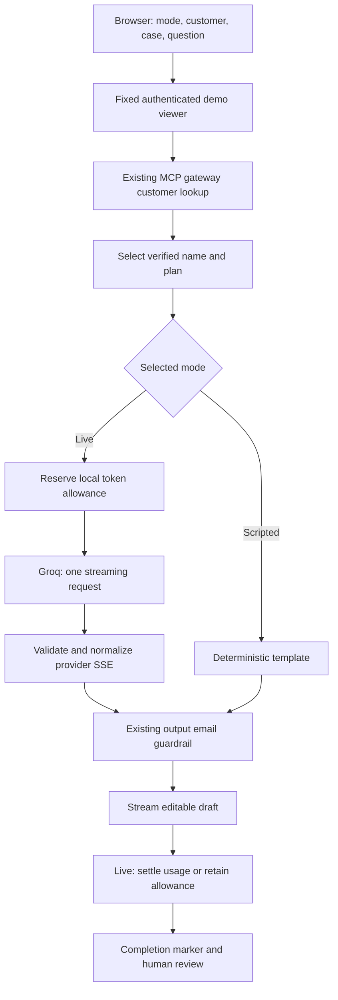

# Support Copilot Stage B — Groq Live AI

Developed by **Yu-Chen Su**. Implemented November 9, 2026.

> November 13 update: a minimal real Groq request verified the configured key, model access, streamed completion, and usage reporting (76 input / 18 output tokens). The user also reported that the Live demo works. Full customer-support answer-quality acceptance remains outstanding; the implementation-time evidence below is historical. [Stage C](COPILOT_STAGE_C.md) now adds local failure demonstrations.

Stage B adds optional cloud AI generation to the existing local English workbench. The application retrieves a fictional customer through the authenticated MCP gateway, asks Groq to draft a relevant English support reply, filters supported output email formats, and streams an editable draft. The model cannot choose tools, send messages, issue refunds, or change customer records.

Implementation and simulated-provider verification are complete. **Real Groq connectivity, account/model access, and answer quality remain unverified because no API key is configured in the implementation environment.** Historical Tasks 1–4 and Stage A records retain their original scope.

## Setup with a Free-plan account

1. Create a key in [Groq Console](https://console.groq.com/keys) using an account on the **Free plan**. Confirm the plan and available models in that account. Do not upgrade to Developer for this demo.
2. Use Node 24 and the installed project dependencies. If `.env` does not exist, copy the template:

   ```sh
   cp .env.example .env
   ```

3. Edit `.env` locally. Set `GROQ_API_KEY` to your key. Leave `GROQ_MODEL=openai/gpt-oss-20b` for the first run. The only other currently accepted model is `openai/gpt-oss-120b`; both must be available to your account. Do not paste the key into chat, source code, or the browser. `.env` is ignored by Git.
4. Stop any previous workbench process and restart:

   ```sh
   npm run demo:copilot
   ```

5. Open **http://127.0.0.1:3040/**. Choose **Live AI · Groq**, select a fictional customer, enter a support question, and generate. Live availability means a key is configured, not that Groq has validated it. Authentication and model-access errors appear when a request is made.

The command loads optional `.env` values into the server; existing exported environment variables take precedence. A blank or absent key leaves Scripted mode available and Live disabled. Restart after changing configuration. Unsupported model IDs fail startup with a sanitized message.

The application cannot inspect or enforce your Groq billing plan. A paid account can incur charges. No code in this project upgrades plans, configures payments, or switches providers. Free-plan limits can return 429. The UI asks you to wait or explicitly switch to Scripted; it never substitutes a template for a failed live answer.

## Request flow



`POST /copilot/draft` adds `mode: "scripted" | "live"`, defaulting to `scripted` for older clients. Other fields keep the Stage A constraints. The browser cannot supply a key, provider URL, model, role, tenant, or token allowance. `GET /api/catalog` includes only live availability, provider name, and configured model. Credentials are never returned.

The model receives two messages: fixed drafting instructions and JSON containing verified name/plan, case type, and the user's question. It is asked to write at most 180 words, acknowledge the question, ask for missing information, and avoid invented account actions, policies, or billing facts. These are prompt instructions, not guarantees of factual correctness. The sample-email checkbox requests a fictional address in the model's output; the model may omit it. The checkbox remains deterministic in Scripted mode.

## Groq adapter

- Fixed endpoint: `https://api.groq.com/openai/v1/chat/completions`. Native `fetch`, no added dependency, no automatic retries, no redirects, and no tools.
- Request settings: `stream: true`, `n: 1`, `max_completion_tokens: 1024`, `reasoning_effort: "low"`, and `include_reasoning: false`. The adapter only forwards content deltas and ignores separate reasoning fields.
- Incremental UTF-8/SSE parsing handles fragmented bytes. Wire input is capped at 1 MiB, SSE lines/events at 64 KiB, and normalized frames are split into bounded chunks before the existing guardrail.
- Require an accepted finish reason and `[DONE]`. EOF alone, malformed frames, invalid UTF-8/surrogates, unexpected tool calls, or an empty answer fail. `finish_reason: "length"` reports an incomplete draft even if partial text is visible.
- Live reads allow ten seconds; the whole workbench request remains limited to thirty seconds. Existing scripted/mock guardrail reads retain their three-second default. Slow browser writes apply backpressure.
- Stop, reset, disconnect, timeout, and server shutdown abort provider I/O. Cancellation cannot guarantee that Groq consumed zero tokens.

HTTP failures are mapped to stable UI codes for rate limits, access rejection, invalid requests, unavailable service, or timeouts. Provider error bodies are not read or logged. A failure after streamed text leaves an explicitly incomplete draft and never starts another provider attempt.

## Local token budget and usage

Live mode reuses `TokenBudget` from Task 4, with a separate file at `data/copilot-budget.sqlite` and the fixed authenticated tenant `copilot-demo`. All workbench browser sessions share that budget. It allows **8,000 tokens per sixty-second settlement window**, with a 120-second reservation lease. The directory and SQLite files are ignored by Git; restarting the demo retains the ledger.

Before any Groq call, reserve:

```text
UTF-8 byte count of both message contents
+ 256 tokens of chat-template margin
+ 1,024 maximum completion tokens
```

This is a conservative admission estimate, not an exact model-tokenizer count. It is not a guarantee against Groq rate limits. Groq quotas apply independently, may include daily/request limits, and may be shared with other applications. The local budget is not a dollar spending limit or a provider quota display.

After terminal `[DONE]`, validate provider-reported `prompt_tokens`, `completion_tokens`, and `total_tokens` from `x_groq.usage` or top-level `usage`. Totals must agree; duplicate reports must match. Known usage replaces the reservation. Valid over-reported totals are charged before the request fails; exceeding an individual input/output allowance also fails. The reported completion count is used without deriving usage from visible characters or stripping any provider-accounted reasoning cost.

Missing usage, interrupted streams, malformed usage, and non-success HTTP responses retain the entire reservation as unknown. This includes 429, conservatively, rather than assuming the provider incurred zero usage. A clean reply with missing usage can finish, but the UI explicitly says **Unknown** and shows the retained allowance in the timeline. If the browser disconnects before it can receive a receipt, the backend still settles. A ledger failure prevents success.

Completed charges expire sixty seconds after settlement. Active reservations do not expire with the historical window; after the 120-second lease, the next ledger operation conservatively charges them for a fresh window. Budget capacity is a snapshot at settlement, not a continuously refreshed quota counter. Budget exhaustion stops the call before provider I/O. Scripted mode has no model charge and does not touch the ledger.

## Data and product boundaries

The question and verified customer name/plan are transmitted to Groq. The customer-record email and customer ID are excluded from generation context. **An email entered in the question is not masked before transmission.** Output email redaction covers the previously documented common ASCII formats; it is not comprehensive PII detection or an input privacy guarantee. Use fictional questions for this demonstration.

Existing local demo authentication, loopback binding, exact-origin requirements, four-stream cap, sanitized logs, and safe text rendering remain in place. This is not a production login or a publicly hosted service. Tenant token accounting does not provide customer data isolation. Live fallback, additional providers/Ollama, production auth, business-system integration, and deployment remain separate work.

## Verification

On November 9, 2026, `npm run check` passed server/browser type checking, both builds, and **111 tests/subtests** using installed dependencies on Node **24.22.1**. Loopback HTTP tests required execution outside the restricted sandbox.

Coverage includes the original regression suite plus Groq wire parsing and normalization, UTF-8/email splits, prompt context selection, reasoning exclusion, known/unknown usage, over-reports, ledger failures/restarts, rate limits and access errors without retries, malformed/truncated/oversized streams, deadlines, cancellation, consumer return, live HTTP mode admission, concurrent customer isolation, shutdown, and preserved Scripted behavior. Groq responses in automated tests are simulated; no real account is charged.

Browser verification also covered disabled Live mode without a key, an actual Scripted billing draft with email redaction, and intercepted Live SSE for known/unknown usage, 429 feedback, and reset. Those intercepted responses are UI fixtures, not real Groq calls. Final desktop and 390-pixel mobile layouts were inspected; the mobile page has no horizontal overflow.

The remaining live acceptance check is to configure a Free-plan key, generate account/billing/access replies, change the question and confirm relevant changes, review for invented facts or actions, inspect actual usage, and stop an active request. Successful API access alone does not establish answer quality. No fresh dependency installation, new remote CI run, deployment, or real Groq response is claimed here.

## Implementation map

| File | Responsibility |
| --- | --- |
| `src/copilot/groq.ts` | Fixed-endpoint transport, provider SSE validation, usage extraction, cancellation. |
| `src/copilot/generation.ts` | Prompt, input allowance, local reservation and settlement, usage events. |
| `src/copilot/workflow.ts` | Deterministic MCP lookup followed by the selected generation mode. |
| `src/copilot/server.ts` | Mode admission, availability metadata, session boundary, SSE response. |
| `scripts/start-copilot.ts` | Server-only configuration, persistent live ledger, local stack lifecycle. |
| `web/app.ts`, `web/index.html` | Explicit modes, model/usage display, failure messages, stop/reset. |
| `tests/groq.test.ts`, `tests/copilot.test.ts` | Adapter, accounting, lifecycle, and HTTP integration verification. |

## Provider references

Reviewed November 9, 2026: [Chat API reference](https://console.groq.com/docs/api-reference), [streaming text generation](https://console.groq.com/docs/text-chat), [GPT-OSS reasoning settings](https://console.groq.com/docs/reasoning), [official streaming type definitions](https://github.com/groq/groq-typescript/blob/main/src/resources/chat/completions.ts), [available models](https://console.groq.com/docs/models), [rate limits](https://console.groq.com/docs/rate-limits), and [billing plans](https://console.groq.com/docs/billing-faqs). Account access and limits can change; confirm them in your own console.
