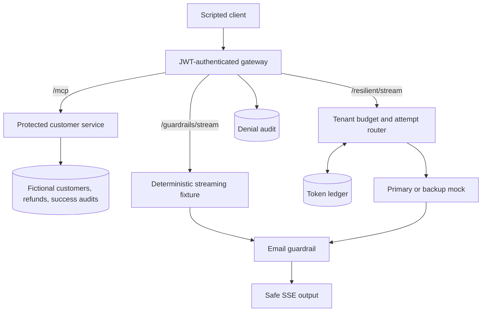

# BridgeLayer — Project overview and four-task closeout

**Status: all four agreed prototype tasks are complete as of November 3, 2026 (Asia/Taipei).** The final implementation revision is `dc381faccc90b8baea5da1cb6a45b6eba7a7c2c7`. Completion covers the local, fictional-data and deterministic-provider scope; optional product extensions are separate work.

## What this project does

BridgeLayer is a backend prototype for controlled customer-support tool access and guarded streaming responses. It demonstrates the infrastructure a support application could use to check caller permissions, execute business operations, filter supported email patterns from generated text, and control model usage and failure behavior.

There are two demonstrated workflows. A scripted MCP client looks up fictional customers and creates simulated refund receipts through validated tools. A separate streaming client requests predefined provider fixtures, receives email-redacted text, and can exercise token budgets and a primary/backup provider sequence. The latter uses deterministic mocks; a real AI model is not connected and does not choose or invoke the customer tools.

The useful result is a reproducible engineering demonstration: successful requests and deliberately injected failures show where identity, authorization, validation, persistence, redaction, accounting, and cancellation are enforced.

## The four completed tasks

| Task | What it delivers | Example | Completion evidence |
| --- | --- | --- | --- |
| 1. Customer MCP service | Discoverable customer lookup and simulated refund tools; strict validation and atomic SQLite refund/audit writes. | A valid refund request creates a USD receipt; an invalid amount is rejected without writing a refund. | [Stdio walkthrough](01-mcp-walkthrough.md), regression tests included in the final verified suite. |
| 2. HTTP security gateway | Demo JWT authentication, viewer/admin execution policy, separate downstream credentials, durable denials, and bounded proxy failures. | A viewer can discover `admin_health_check` but cannot execute it; the denied call never reaches the service. | [Task 2 closeout](TASK2_CLOSEOUT.md). |
| 3. Streaming email guardrail | Incremental UTF-8/SSE/JSON parsing, bounded inspection, email-token replacement, cancellation, and backpressure. | `alex`, `@example`, and `.com` arriving in separate fragments are held and replaced before release. | [Task 3 closeout](TASK3_CLOSEOUT.md). |
| 4. Token budgets and fallback | Atomic per-tenant reservations, known/unknown usage settlement, restart recovery, and one backup attempt before output. | A primary 429 or first-text timeout can switch to a separately admitted backup; a failure after output cannot splice in another answer. | [Task 4 closeout](TASK4_CLOSEOUT.md). |

## How requests travel



The original stdio entry point also exposes the two customer tools without the HTTP gateway. The persistent HTTP launcher runs two loopback listeners in one process: gateway port 3030 and protected customer service port 3031 by default. These are separate HTTP credential boundaries, not isolated operating-system processes.

| Entry point | Input and output | Role |
| --- | --- | --- |
| stdio | MCP messages over the spawned process's standard input/output | Original local tool integration. |
| `/mcp` | MCP initialization, discovery, and tool calls | Authenticated customer-tool access; customer results keep their original contents. |
| `/guardrails/stream` | Fixed fixture request → redacted SSE text | Isolates and demonstrates streaming email handling. |
| `/resilient/stream` | Fixed fixture/scenario request → budgeted, redacted SSE text | Combines model-attempt accounting, bounded fallback, and the email guardrail. |

## A concrete support example

A developer-operated client authenticates as a viewer, discovers available MCP tools, looks up `CUST-00001`, and creates a simulated $12.50 refund. The service validates the request and atomically stores the receipt and success audit. The same viewer is denied an admin tool call before forwarding.

Separately, the streaming demo emits a synthetic support sentence containing an email split across fragments. The guardrail holds the unresolved token and returns `Contact [REDACTED_EMAIL] for help.` In the resilience demo, each model attempt first reserves its tenant allowance. A qualifying primary failure may lead to one backup; unknown primary usage remains charged conservatively. Once any output has been emitted, the request must finish or fail with that attempt.

These are demonstrated components for a future support application. There is no autonomous conversation connecting customer lookup, refund decisions, and model output today.

## What is real and what is simulated

| Implemented and exercised | Simulated or not implemented |
| --- | --- |
| MCP protocol server and SDK clients | Customers are fictional; no CRM is connected. |
| JWT validation, tool policy, service credential boundary | Tokens are local demo credentials; no complete OAuth service exists. |
| SQLite persistence and atomic transactions | Refunds are receipts only; no payment provider is called. |
| Incremental email redaction, resource limits, cancellation | No general PII detection; unsupported or obfuscated formats may pass through. |
| Atomic token ledger and primary/backup control flow | Providers and token counts are synthetic; no live LLM or tokenizer is connected. |
| Tenant-specific budget counters | Customer rows are shared; there is no tenant-aware customer-data model. |
| Local tests, demos, and GitHub CI | No React UI, hosted deployment, or measured production capacity. |

The redactor replaces whole email-containing whitespace tokens, so it may remove surrounding punctuation or over-redact malformed addresses. It applies to the streaming routes, not customer MCP responses. The token policy demonstrates accounting rules, not actual model billing.

## Final verification

The November 1 local validation passed strict type checking, build, and **66 tests/subtests** on Node **22.23.4** and **24.22.1**. All four demos passed on Node 24. Task 3 also has recorded synthetic streaming measurements with explicit conditions and limits.

The final [GitHub Actions run](https://github.com/willsu42/bridgelayer-mcp/actions/runs/41320833908) passed `npm ci` and `npm run check` on both Node 22 and 24 for `dc381fa`. Results were verified November 3; job links and evidence boundaries are in [TASK4_CLOSEOUT.md](TASK4_CLOSEOUT.md). The final suite includes regression coverage for all four tasks. This closeout did not rerun tests or publish code.

No agreed prototype acceptance item remains open. Existing scope documents and dated closeouts retain their historical attribution; this report does not backdate implementation or turn mock behavior into a production claim.

## Try the completed prototype

Use Node 24, then:

```sh
npm ci
npm run check
npm run demo
npm run demo:http
npm run demo:streaming
npm run demo:resilience
```

`npm run bench:streaming` reproduces the synthetic streaming measurements. For persistent operation and credential configuration, see [README](../README.md).

Future work can connect a live provider, add a support console, integrate a real customer system, or prepare deployment. Each would need its own scope, credentials/data decisions, and verification. None is required to close Tasks 1–4.
