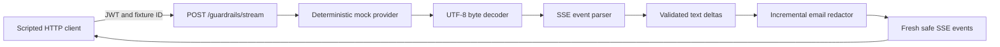

# Task 3 — Streaming PII guardrails implementation plan

Drafted October 28, 2026 (Asia/Taipei). **Status: implemented and locally verified; remote CI for the new code remains pending.** Task 2 is complete; its evidence remains in [TASK2_CLOSEOUT.md](TASK2_CLOSEOUT.md). This is the next-phase proposal, not an expansion of the completed September scope.

## Implementation status — October 28

The user authorized development after confirming email-only scope. Milestones 1–6 are implemented; milestone 7 has local Node 22/24 validation, three demos, and measured results, with remote CI still pending. The original proposal below is retained as the design baseline. The [walkthrough](03-streaming-guardrails-walkthrough.md) records the exact adopted detector, error, and resource contracts; [validation](TASK3_VALIDATION.md) distinguishes measured local evidence from outstanding CI.

Implementation refinements: substring matching intentionally redacts malformed surrounding tokens; SSE event byte accounting normalizes CRLF; 64 consecutive empty source chunks are allowed before rejection; request-body timeout is HTTP 408; peak output-frame size is measured separately; benchmark timing starts at pipeline invocation, excluding HTTP/authentication. Hand-authored and independent fixture-policy tests replace any claim of universal PII detection. The benchmark reports aligned safe-prefix delay only where a comparable span exists.

## Outcome and confirmed PII scope

Demonstrate that supported sensitive text is redacted before reaching a streaming client, even when bytes, provider events, and text fragments split at different positions. Deliver a reusable pipeline, deterministic mock provider, authenticated local HTTP demo, automated tests, and measured latency/buffer results.

The user confirmed **email addresses only** on October 28, 2026. The proposed detector targets common ASCII email addresses; its exact grammar will be finalized in milestone 1. Phone-number detection is deferred to a separate follow-up. Names, postal addresses, government IDs, payment cards, obfuscated addresses, internationalized email, and semantic PII detection are outside this first detector's guarantee. This is a format-specific guardrail, not a claim that all output is free of PII.

Use synthetic fixtures and existing TypeScript, Zod, Node HTTP, and test-runner infrastructure. No live LLM, API key, autonomous tool use, UI, database migration, token budget, model fallback, or new package is required by this proposal. Token reservations and routing remain Task 4.

## Architecture and integration boundary

The mock is an injected asynchronous byte source, with no network access or user-selected URL. It exercises the same byte/event pipeline that a future provider adapter would feed. Real HTTP is used between the client and gateway; do not describe the mock as an actual provider integration.

Keep `/mcp`, its JSON-RPC contracts, the protected customer service, and stdio behavior intact. The existing gateway validates a complete downstream JSON reply and is not a streaming proxy. Add a separately routed handler for `/guardrails/stream`; share JWT verification and Host/Origin checks without making MCP headers or envelopes mandatory on the new route. Make any common-validator refactor explicit and retain regression tests for `/mcp`.

Proposed provider boundary: `open({ fixture, signal }): AsyncIterable<Uint8Array>`. Every request owns its decoder, parser, redactor, timers, counters, and cancellation state. A future provider adapter may implement this interface; provider-specific auth, usage accounting, and network retries are not part of Task 3.

## Contracts to freeze in milestone 1

| Boundary | Proposed contract |
| --- | --- |
| Request | `POST /guardrails/stream`, JSON `{ "fixture": "split-email" }`; strict fixture enum, no extra fields or arbitrary prompt/URL. `Accept: text/event-stream`. |
| Authorization | Existing valid viewer/admin demo JWTs may run synthetic fixtures. Authenticate before body parsing/provider invocation; invalid credentials produce 401 and zero provider starts. Use existing denial audit behavior. |
| Mock provider events | SSE `event: delta` with strict JSON `{ "text": "..." }`, followed by `event: done` with `{}`. Comments allowed. Unknown application event types or invalid payloads terminate the stream. |
| Client output | Newly serialized `delta` events with only redacted text, then exactly one `done` event on success. Generate a request ID server-side and return it in `X-Request-ID`; do not echo arbitrary request text. |
| Replacement | `[REDACTED_EMAIL]` for a detected email-containing token; `[REDACTED_OVERSIZE]` for an overlong unresolved token. No hashes or reversible replacements. |
| Errors before streaming | Sanitized JSON error: 400/413/415/406 for input violations, 401 for invalid credentials, 502 for malformed provider data, 504 for timeout, 503 for concurrency exhaustion. No JSON-RPC codes on this route. |
| Errors after streaming begins | Emit one fixed-code `error` event if writable, then close; no `done`, no pending raw-text flush, no HTTP status rewrite. On disconnect, close/abort without attempting further output. |

Rebuild outbound events from allowlisted fields; never relay raw provider events, error messages, metadata, or SSE IDs. Successful completion requires an explicit valid provider `done`; a bare EOF is a truncated-stream error. After `done`, stop consuming and close the source. Clients use a POST-capable streaming client, with no reconnect/replay behavior.

## Redaction policy and buffering

Start with a conservative, testable policy: accumulate one non-whitespace text token across deltas. Only inspect/release it at a whitespace boundary or valid provider completion. If it contains a supported email match, replace the **whole token**. Otherwise release it unchanged. Preserve the delimiting whitespace. This may remove adjacent punctuation or other text in the same token; record this intentional false-positive tradeoff.

Milestone 1 must specify the exact ASCII local-part and domain grammar, matching boundaries, case behavior, length limits, and examples. Start with dot-separated local atoms, common plus tags, and a domain containing at least one dot; exclude quoted local parts and domain literals. Examples include `alex@example.com`, `alex+support@example.co.uk`, surrounding punctuation, multiple addresses, near matches, and Unicode text beside an ASCII address. The fixture table is the contract; do not claim full email-standard validation.

Never release a token prefix because it has not matched an email *yet*. A safe-looking `alex` may later become `alex@example.com`. A fixed trailing-character window alone is insufficient for the proposed policy.

If a token exceeds the pending-text cap, emit one oversize marker, discard its remaining characters until whitespace, then resume normally. Do not release any part of that token. There is no timer that flushes ambiguous text. On failure/cancellation, discard pending text; on valid completion, inspect the final token before release. Successful output must be invariant to byte and text chunking under this policy, including oversize suppression.

## Parser and lifecycle requirements

Use incremental UTF-8 decoding so a split multibyte character survives. Reject malformed UTF-8 and an incomplete final byte sequence; this is an intentionally stricter policy than permissive replacement decoding. Parse event framing before parsing JSON, then inspect only validated text deltas. JSON escapes such as `\u0040` must be decoded before redaction. Reject unpaired surrogate escapes rather than treating them as ordinary text.

Handle LF, CRLF, and CR line endings, split delimiters, a leading BOM, comments, multiple `data:` lines, and multiple events per input chunk. Ignore protocol fields that are not used by the application without forwarding them. Apply line/event limits incrementally, including ignored fields and comments. An unfinished event at EOF must not be treated as a valid completed delta. Framing behavior is based on the [WHATWG SSE specification](https://html.spec.whatwg.org/multipage/server-sent-events.html#parsing-an-event-stream); the provider `delta`/`done` schema is our own mock contract.

Propagate an `AbortSignal` through source reads and output waits. Stop pulling input while the consumer is blocked; for HTTP writes, wait for `drain` or termination when `write()` returns false. Bound individual writes and handle close/error/abort while waiting. Release iterators/readers, timers, and listeners on every exit. Node documents the relevant [writable backpressure behavior](https://nodejs.org/api/stream.html#event-drain) and [incremental TextDecoder interface](https://nodejs.org/api/util.html#class-utiltextdecoder); validate actual implementation on the project's Node 22/24 matrix.

Proposed defaults below are engineering limits to validate, not measured capacity or token-budget claims:

| Resource | Initial limit / behavior |
| --- | --- |
| Request body | 4 KiB; three-second body-read deadline. |
| Pending non-whitespace token | 4 KiB in UTF-8 bytes; suppress until delimiter on overflow. |
| Provider line/event | 64 KiB each, enforced before accumulating beyond the limit. |
| Source chunk / decoded delta | 16 KiB each; adapter contract bounds chunks and rejects oversized deltas. |
| Total provider bytes | 1 MiB per request; abort on overflow. |
| Application output queue | At most one bounded pending write; no whole-answer accumulation. |
| Concurrent streams | Four per local gateway process; reject excess before starting the provider. |
| Waiting for next provider data | Three seconds while actively awaiting a read; paused during downstream backpressure. |
| Total request duration | Thirty seconds including slow-consumer waits; abort when exceeded. |

Measure parser, pending-text, and application-output buffers separately. These bounds do not claim to cap total process RSS, OS socket buffers, or all future provider-library allocations. A long run without whitespace delays safe output; bounded memory does not guarantee low latency.

## Ordered implementation milestones

| Milestone | Deliverables / likely files | Exit criteria |
| --- | --- | --- |
| 1. Freeze scope and fixtures | Detector grammar, fixture table, event/error contract, reviewed limits; `docs/03-streaming-guardrails-walkthrough.md`, `tests/fixtures/streaming.ts` | Supported/unsupported email cases and expected output are explicit; email-only scope is confirmed and phone detection is excluded. |
| 2. Decode bytes and provider events | `src/streaming/decoder.ts`, `sse.ts`, `provider.ts`, `mock.ts`; parser tests | Split UTF-8/SSE/JSON cases parse correctly; malformed/truncated/oversized input fails without forwarding raw payloads. |
| 3. Redact incremental text | `src/streaming/redactor.ts`; detector and chunk-boundary tests | All supported matches are suppressed before emission; clean tokens/whitespace preserved; final-token and oversize behavior match the contract. |
| 4. Compose lifecycle and limits | `src/streaming/pipeline.ts`; cancellation/backpressure tests | No unbounded queue, no ambiguous flush on errors, source stopped on cancellation, per-request state isolated. |
| 5. Add authenticated HTTP path | `src/streaming/http.ts`, targeted gateway/common/launcher changes; HTTP integration tests | Real client receives only sanitized events; auth failures start no provider; slow-client, shutdown, and concurrency cases pass; `/mcp` regressions remain green. |
| 6. Demonstrate and measure | `scripts/demo-streaming.ts`, `scripts/benchmark-streaming.ts`; planned `demo:streaming` / `bench:streaming` commands | Synthetic success/failure demo completes without external keys; report latency and buffer observations with reproducible fixture settings. |
| 7. Verify and close | Node 24 clean install, full suite, all three demos, actual Node 22/24 CI evidence, documentation updates | Acceptance matrix below passes; limitations and measurements published; Task 3 status updated only after evidence exists. |

Dependency order: **1 → 2 → 3 → 4 → 5 → 6 → 7**. Keep changes reviewable by milestone; do not estimate completion dates before the exact email grammar and milestone 1 cases are agreed. Existing test glob `dist/tests/*.test.js` requires new test files directly under `tests/`, unless deliberately updated.

## Acceptance matrix

| Area | Required evidence |
| --- | --- |
| Split safety | Every two-part split at each byte position of short wire fixtures; every text split through each supported email; byte-at-a-time and seeded multi-split cases. |
| Independent correctness | Hand-authored expected outputs plus a simple whole-input reference policy for successful streams; assert emitted prefixes contain only resolved/redacted tokens, not merely that final concatenation looks safe. |
| Event boundaries | Email split across several valid delta events; several events in one chunk; escaped `@`/dot, multiline data, all newline styles, comments, BOM, empty deltas, Unicode adjacent to email. |
| Completion and failure | Final token without trailing whitespace; missing `done`; malformed JSON/UTF-8; incomplete event; upstream exception; no pending-text release on any error. |
| Bounds | Exact limit and one-over cases; long ambiguous tokens followed by a delimiter; repeated oversize tokens; comments without data; measured buffer high-water marks stay within declared limits. |
| Lifecycle | Slow sink blocks input pulls; cancellation during read and drain; client disconnect; server shutdown; cleanup occurs once; no retries or automatic replay. |
| HTTP/auth | Missing/invalid/expired JWT invokes no provider; Host/Origin rejection; strict request schema; errors before/after first write; slot recovery after failure; concurrent streams cannot mix text/state. |
| Privacy | Captured HTTP output and diagnostics exclude raw synthetic PII and provider payloads on failure paths; logs contain only IDs, fixed outcomes, counts, durations, and buffer metrics. |
| Compatibility | Existing 23 tests/subtests pass; stdio and HTTP MCP demos remain valid; new tests join `npm run check` and Node 22/24 CI. |

Use injected clocks/schedulers for deadline races and deterministic assertions; avoid timing thresholds that depend on CI machine speed. For parser/redactor unit tests, inspect each emission as well as final output. For end-to-end tests, inspect reconstructed SSE events because TCP chunk boundaries are not controllable.

## Measurement and delivery

Benchmark the same paced synthetic streams through an unredacted internal reference path and the guarded path. The reference path exists only in the benchmark harness and must not be exposed by the gateway. Cover plain text, split email, email-heavy text, long ambiguous text, malformed input, and a slow consumer.

Report time from request admission to first **non-empty safe delta** (exclude headers/control events), added release delay for aligned safe spans, total completion time, input/output bytes, redaction/suppression counts, and peak buffers per stage. Use `N/A` for streams with no emitted text. Record runtime, machine, fixture size, chunk schedule, consumer delay, sample count, and median/p95. Separate intentional look-ahead/source pacing from processing time. No numeric latency claim or performance pass threshold is established yet; deterministic correctness and boundedness are release gates.

Final artifacts: working pipeline/endpoint, tests, reproducible demo and measurement commands, walkthrough with supported-format table and limitations, benchmark results, and Task 3 closeout linked from README/roadmap/handoff. Preserve Task 2's historical evidence. Task 4 can later add budget/provider routing around the provider boundary without changing the safe-output contract.
