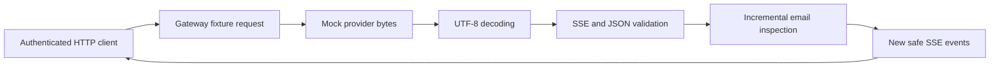

# Task 3 progress report — Streaming email guardrails

**As of October 29, 2026 (Asia/Taipei); implementation and local measurements dated October 28.**

Task 3 now has a working local prototype that detects supported email patterns in streamed text and replaces them before they reach the client. It includes an authenticated HTTP endpoint, deterministic provider fixtures, automated tests, a runnable demo, and benchmark results. The implementation is recorded in commit `6eb5604` (`develop task 3 proto`). Remote Node 22/24 CI has now been verified for this implementation and the subsequent `b0ef476` revision. **Task 3 is complete within the agreed scope**; see the [closeout](TASK3_CLOSEOUT.md).

## What we set out to solve

Streaming output arrives in fragments. A sensitive address might arrive as `alex`, then `@example`, then `.com`. Checking each fragment independently could release part of the address before recognizing it. Network chunks can also split UTF-8 characters, JSON strings, and event delimiters.

We separated those boundaries and added a stateful inspection step that holds unresolved text until it can make a decision. The agreed first scope is **email addresses only**, using synthetic data and a mock provider.

## What is implemented

| Area | Delivered behavior |
| --- | --- |
| Provider interface and mock | An abort-aware asynchronous byte source with six deterministic fixtures: plain text, split email, email-heavy text, a long token, malformed data, and truncated output. |
| Byte decoding | Incremental UTF-8 decoding, including multibyte characters split across chunks; malformed input fails closed. |
| Event parsing | Bounded SSE parsing followed by strict JSON validation; handles split delimiters, newline variants, multiple events per chunk, comments, and escaped text. |
| Email inspection | Holds non-whitespace tokens across text deltas and replaces an email-containing token with `[REDACTED_EMAIL]`. |
| Overflow handling | Replaces an unresolved token exceeding 4096 bytes with `[REDACTED_OVERSIZE]`, then discards the rest of that token until whitespace. |
| HTTP integration | Adds `POST /guardrails/stream` to the existing gateway, sharing JWT verification and Host/Origin checks. Viewer and admin roles may run the synthetic fixtures. |
| Lifecycle controls | Bounds request/provider input, limits concurrent streams, propagates cancellation, handles timeouts, and stops pulling input when the client is blocked. |
| Diagnostics | Records generated request IDs, outcomes, durations, byte counts, redaction counts, and peak logical buffers without logging text or credentials. |
| Developer workflow | Adds `npm run demo:streaming` and `npm run bench:streaming`; existing MCP demos continue to work. |

The data path is:



The streaming route is ordinary HTTP/SSE. It does not change the MCP transport or add an MCP tool. Existing customer lookup and simulated refund results retain their original behavior.

## Important implementation choices

**Hold a whole whitespace-delimited token.** An unresolved prefix is never released just because it does not yet match an email. If a token contains a supported ASCII email substring, the entire token is replaced. For example, `Contact alex+support@example.co.uk now.` becomes `Contact [REDACTED_EMAIL] now.` This intentionally removes adjacent punctuation or other text in the same token and can redact malformed addresses.

**Require explicit completion.** A valid provider `done` event permits inspection and release of the final token. Bare EOF, malformed input, cancellation, and timeout do not flush pending text. If a failure occurs after safe output has begun, the stream emits a fixed error event when writable and closes without a success event. A blocked or disconnected socket is closed directly.

**Bound each stage.** The current limits are 4 KiB for the request and pending token, 16 KiB for a source chunk or text delta, 64 KiB for a provider line/event, and 1 MiB of total provider input. Four requests may be admitted per process. Provider reads have a three-second deadline; the HTTP request has a thirty-second total deadline. Repeated empty source chunks are also bounded. These are application limits, not production capacity measurements.

**Keep provider details separate from safe output.** Outbound SSE events are rebuilt from allowlisted fields. Provider metadata, raw errors, and arbitrary payloads are never relayed. A future live adapter can use the byte-source interface, but must honor cancellation and the input bounds.

## What we verified

Local results below were recorded during implementation on October 28. The remote CI row was verified October 29; this documentation update did not rerun the local suite.

| Verification | Recorded result |
| --- | --- |
| Clean dependency installation | Passed on Node 24.22.1 using the existing lockfile and a populated npm cache. No dependency versions changed. |
| Node 24.22.1 | Type checking, build, and all **42 tests/subtests passed**. |
| Node 22.23.4 | Type checking, build, and all **42 tests/subtests passed** using the installed dependencies. |
| Existing behavior | The original 23 tests/subtests remain green, including HTTP security and stdio persistence checks. |
| New streaming coverage | 19 additional cases cover chunk boundaries, supported patterns, malformed input, buffer limits, cancellation, backpressure, authentication, concurrency, audit failures, and log privacy. |
| Demonstrations | Streaming, HTTP MCP, and stdio demos completed on Node 24. |
| Benchmark | Six scenarios with ten paired reference/guarded samples each; results stored in the repository. |
| Remote CI, verified October 29 | Node 22/24 jobs passed `npm ci` and `npm run check` for both `6eb5604` and `b0ef476`; [run and job links](TASK3_CLOSEOUT.md). |

Boundary tests include every two-part split of a mixed UTF-8/SSE/JSON fixture, every text split through supported email fixtures, byte-at-a-time delivery, and seeded chunk layouts. They check emitted prefixes as well as final output, using hand-authored expectations and an independent policy over known synthetic addresses. Controlled writable tests verify that backpressure stops source reads; real HTTP tests verify disconnect and shutdown cancellation.

The benchmark observed a median first safe output of approximately **1.23 ms** for the split-email fixture and a maximum pending-token buffer of **4096 bytes** in the long-token fixture. These small, paced mock runs exclude HTTP/authentication and include scheduling delays. They establish reproducible observations, not a latency SLA or production throughput claim. Exact results and conditions are in [TASK3_VALIDATION.md](TASK3_VALIDATION.md).

## What remains outside the prototype

- No live LLM/provider calls, external API credentials, or arbitrary user prompts.
- No phone-number, name, address, government-ID, or payment-card detection. Internationalized and obfuscated email forms are not guaranteed.
- No blanket protection for existing MCP responses; fictional customer emails still appear in customer lookup results.
- No token budgets, model fallback, React console, hosted deployment, or new tenant isolation.

All acceptance steps for the agreed Task 3 scope are complete. Additional formats and live provider integration require separate scope decisions. The next workstream is Task 4 design: token reservations, usage reconciliation, and fallback before output begins.

## How to review and run the work

With Node 24 active and dependencies installed:

```sh
npm run check
npm run demo:streaming
npm run bench:streaming
```

| Artifact | Where to look |
| --- | --- |
| Pipeline and resource contracts | [pipeline.ts](../src/streaming/pipeline.ts), [contracts.ts](../src/streaming/contracts.ts) |
| Email policy | [redactor.ts](../src/streaming/redactor.ts), [fixture expectations](../tests/fixtures/streaming.ts) |
| HTTP handler | [http.ts](../src/streaming/http.ts) |
| Tests | [streaming.test.ts](../tests/streaming.test.ts), [streaming-http.test.ts](../tests/streaming-http.test.ts) |
| Demo and measurement harness | [demo-streaming.ts](../scripts/demo-streaming.ts), [benchmark-streaming.ts](../scripts/benchmark-streaming.ts) |
| Detailed behavior and limits | [Streaming walkthrough](03-streaming-guardrails-walkthrough.md) |
| Measured evidence | [Validation record](TASK3_VALIDATION.md), [raw benchmark data](benchmarks/task3-node24-2026-10-28.json) |
| Original plan and milestone status | [Task 3 plan](TASK3_PLAN.md) |
